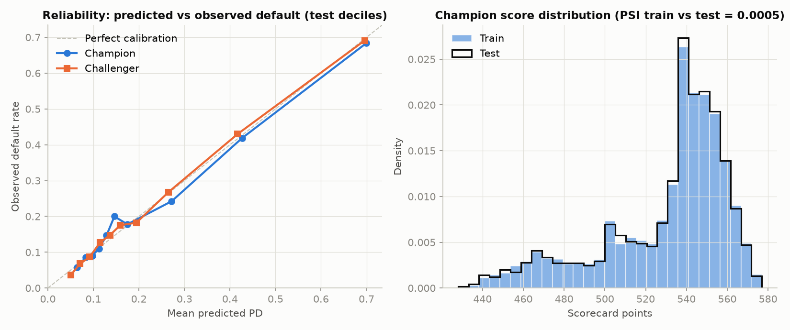

# Credit Risk Scorecard: WoE Logistic Regression vs Gradient Boosting

**Question:** can a transparent, bank-style points scorecard rank credit card default risk as well as a gradient-boosting model?
**Answer:** close, but not quite. On a held-out test set of 9,000 accounts the scorecard reaches AUC 0.764 (KS 0.404) and the gradient-boosting challenger 0.781 (KS 0.424). The gap is small but statistically real (bootstrap 95% CI for the AUC difference: 0.012 to 0.021), and almost all of it sits among the lowest-risk accounts.


## Data

UCI "Default of Credit Card Clients" (id 350): 30,000 Taiwanese cardholders, six months of repayment status, balances and payments (April to September 2005), target = default on the next month's payment. The default rate is 22.12%. The raw zip is cached in `data/` and its SHA-256 is recorded in `reports/metrics.json`. See [`data/README.md`](data/README.md) for field definitions and the dataset's limits. The biggest one: these are existing customers, so this is a behavioural score and "approve / decline" stands in for an account-management decision.

Split: stratified random 70/30 (21,000 train / 9,000 test, seed 42). The test set is used once, for final reporting. All model choices (variable selection, challenger tuning, cutoff) are made on the training set with 5-fold cross-validation.

## Method

**Inputs.** 25 candidate variables: the raw limit, repayment status, balance and payment fields plus six engineered ones (worst delinquency in 6 months, number of delinquent months, current and average utilisation, share of last statement repaid, average payment). `SEX`, `MARRIAGE` and `AGE` are excluded from both models (ECOA prohibited bases) and kept only for the fairness check. `EDUCATION` is excluded by policy (see *What did not work*).

**Champion: WoE logistic regression scorecard** (`src/scorecard/woe.py`, `model.py`, `points.py`)
1. Binning. Numeric variables: quantile pre-bins merged until every bin holds at least 5% of accounts and the bad rate is strictly monotonic. Repayment status `PAY_1`..`PAY_6` is binned as categories (levels under 5% pooled), because -2 / -1 / 0 are different behaviours rather than points on a scale.
2. Weight of Evidence, WoE = ln(%good / %bad), and Information Value per variable ([`reports/iv_table.csv`](reports/iv_table.csv)).
3. Variable selection, in order: drop IV < 0.02 (weak); drop if IV varies across 5 folds by more than 25% (unstable); among WoE variables correlated above 0.70 keep the higher-IV one; fit the regression and drop wrong-sign coefficients, then coefficients with p > 0.05, one at a time.
4. 11 variables survive. All coefficients are negative (correct sign for WoE inputs) with p < 0.05 ([`reports/champion_coefficients.csv`](reports/champion_coefficients.csv)).
5. Scaling: **PDO = 20, 600 points at good:bad odds of 50:1** (factor 28.854, offset 487.12). Each attribute's points = -(b_j x WoE + b0/n) x factor + offset/n, rounded to integers ([`reports/scorecard_points.csv`](reports/scorecard_points.csv)). The rounded integer score loses almost nothing: test AUC 0.7634 vs 0.7640 for the unrounded model.

**Challenger: gradient boosting** (`sklearn` HistGradientBoostingClassifier) on the same 25 variables. Four configurations compared by 5-fold CV on the training set. The shallowest won (7 leaves, learning rate 0.03, CV AUC 0.7857); the deepest (63 leaves) was worst (0.7812).

**Evaluation.** 5-fold CV on train (the whole champion pipeline, binning and selection included, is refit inside every fold) and one pass on the held-out test set: AUC, Gini, KS, Brier, decile calibration with Hosmer-Lemeshow, and PSI of the score between train and test.

## Results

| | Champion (scorecard) | Challenger (GBM) |
|---|---|---|
| CV AUC, mean ± sd (5 folds) | 0.7748 ± 0.0107 | 0.7857 ± 0.0116 |
| CV KS | 0.4251 | 0.4368 |
| CV Brier | 0.1355 | 0.1334 |
| **Test AUC** | **0.7640** | **0.7807** |
| Test Gini | 0.5280 | 0.5615 |
| Test KS | 0.4038 | 0.4245 |
| Test Brier | 0.1388 | 0.1354 |
| Hosmer-Lemeshow p (test, 10 deciles) | 0.0002 | 0.285 |
| Train AUC | 0.7771 | 0.7978 |
| PSI, train vs test score | 0.0005 | 0.0009 |

Source: [`reports/metrics.json`](reports/metrics.json), [`reports/cv_folds.csv`](reports/cv_folds.csv).

- **Discrimination.** The challenger's test AUC is 0.0167 higher (Gini +0.0334), 95% CI 0.0123 to 0.0209 from 1,000 paired bootstrap resamples. Real, but modest.
- **Where the gap is.** At the same approval rate, the bad rate among approved accounts is 7.36% vs 5.60% at 22.8% approval, 9.80% vs 9.31% at 50%, and 16.99% vs 16.90% at 90% ([`reports/matched_approval_comparison.csv`](reports/matched_approval_comparison.csv)). The challenger is better at separating accounts with clean repayment histories, and it does that with the current balance (`BILL_AMT1`) and utilisation (`UTIL_1`), its 3rd and 4th most important inputs by permutation importance. The scorecard dropped both: one for weak IV (0.008), the other for correlation with average utilisation.
- **Calibration.** Both models get the overall default rate right (mean test PD 22.04% and 21.95% vs 22.12% observed). The scorecard is miscalibrated in the middle, though: in the 6th decile it predicts 14.6% and observes 20.0%, and Hosmer-Lemeshow rejects it (p = 0.0002). The challenger passes (p = 0.285).
- **Stability.** PSI is close to zero for both. That is expected with a random split and is **not** evidence of stability over time (see Limitations).



## Business layer

**Assumptions (not in the data):** LGD = 75% (unsecured card), EAD = current balance + 50% of the undrawn limit (CCF = 0.5), and annual net revenue of 8% of EAD on accounts that do not default. Profit per approved account = 8% x EAD if good, -75% x EAD if bad, so break-even PD = 0.08 / (0.08 + 0.75) = 9.6%. Expected loss = PD x LGD x EAD.

The cutoff is chosen to maximise profit on **out-of-fold training scores**, then applied unchanged to the test set:

| Test set, 9,000 accounts | Champion @ 553 points | Challenger @ its own out-of-fold cutoff |
|---|---|---|
| Approval rate | 22.8% | 24.6% |
| Bad rate, approved | 7.46% | 5.70% |
| Bad rate, declined | 26.45% | 27.47% |
| Expected loss on approved (NT$) | 21.44M | 17.22M |
| Realised loss on approved (NT$, at assumed LGD/EAD) | 23.84M | 14.43M |
| Profit (NT$) | 4.53M | 13.02M |
| Profit if every account is approved (NT$) | -73.66M | -73.66M |

The challenger's extra profit is NT$8.49M (bootstrap 95% CI 5.00M to 12.43M). On the whole test book the scorecard's expected loss is NT$130.25M against NT$138.02M realised, so in money terms it under-predicts losses by NT$7.77M.


**The cutoff depends heavily on the assumptions** ([`reports/economics_sensitivity.csv`](reports/economics_sensitivity.csv)). Across LGD 50/75/90% and margin 8/12/16%, the profit-maximising approval rate ranges from 20.5% to 76.2%. At LGD 90% and margin 8% even the best training cutoff loses money on test (NT$-0.05M). The base case approves so few accounts because this book defaults at 22%, far above the 9.6% break-even PD. That is a statement about the portfolio and the default definition, not about the model.

Full cutoff grid (approval rate, bad rate, expected and realised loss, profit by score decile): [`reports/cutoff_table_test.csv`](reports/cutoff_table_test.csv).

### Recommendation

1. **Use the scorecard as the decision model.** Its points are monotonic and auditable, each decline maps directly to specific reasons (Reg B adverse-action notices), and it gives up 0.017 AUC.
2. **Do not ignore the gap.** Under the base-case economics the challenger is worth NT$8.5M more on 9,000 accounts. The next scorecard iteration should try to recover it: bin current balance and utilisation together with delinquency status (the signal the GBM uses), and recalibrate the middle score range.
3. **Set the cutoff with the bank's real LGD, CCF and margin.** The approval rate moves from roughly 20% to 76% across plausible assumptions.
4. If the bank wants the GBM in production anyway, it needs a full model-risk validation (SR 11-7): monotonic constraints, SHAP-based reason codes, and a fair-lending review. On this evidence the lift alone does not justify that cost, but it is close enough to revisit once the scorecard has been improved.

## Explainability

- **Scorecard:** points per attribute in [`reports/scorecard_points.csv`](reports/scorecard_points.csv). By points range, last month's repayment status `PAY_1` dominates (53 points between best and worst attribute), followed by worst 6-month delinquency (16) and status 5 months ago (12).
- **Challenger:** permutation importance on the test set (drop in AUC when a variable is shuffled), [`reports/challenger_permutation_importance.csv`](reports/challenger_permutation_importance.csv): worst 6-month delinquency 0.0347, `PAY_1` 0.0271, current balance 0.0099, current utilisation 0.0096.
- **Reason codes for a declined account** (test row 7, the declined account closest to the median declined score: 535 points vs cutoff 553, PD 15.9%). Reasons are ranked by points lost against the best attribute of each variable ([`reports/reason_codes_sample.csv`](reports/reason_codes_sample.csv)):

| Rank | Reason | Points received | Best possible |
|---|---|---|---|
| 1 | Low average payment amount over 6 months | 44 | 55 |
| 2 | Low credit limit | 44 | 52 |
| 3 | Low payment amount 3 months ago | 47 | 54 |
| 4 | Low payment amount 2 months ago | 47 | 53 |

## Fairness check

At the chosen cutoff on the test set ([`reports/fairness_test.csv`](reports/fairness_test.csv)). The adverse impact ratio (AIR) is each group's approval rate divided by the highest group's.

| Group | n | Approval rate | Default rate (all) | AIR | Below 0.8 |
|---|---|---|---|---|---|
| Female | 5,437 | 22.99% | 20.99% | 1.000 | no |
| Male | 3,563 | 22.51% | 23.86% | 0.979 | no |
| Age < 25 | 802 | 6.73% | 26.68% | 0.255 | **yes** |
| Age 25-34 | 3,856 | 24.14% | 19.71% | 0.915 | no |
| Age 35-44 | 2,707 | 26.38% | 22.05% | 1.000 | no |
| Age 45-54 | 1,302 | 22.81% | 24.96% | 0.865 | no |
| Age 55+ | 333 | 16.82% | 28.53% | 0.638 | **yes** |

By sex the scorecard is close to parity. By age it is not: under-25s and over-55s are approved far less often. Both groups do default more, but that alone does not settle the question. The challenger shows the same pattern (minimum age-band AIR 0.293).

**Regulatory context.** The Equal Credit Opportunity Act and Regulation B prohibit credit discrimination on the basis of race, color, religion, national origin, sex, marital status, age (if the applicant can legally contract), or receipt of public assistance. Leaving `SEX`, `MARRIAGE` and `AGE` out of the model rules out *disparate treatment* by the model. It does **not** rule out *disparate impact*: variables like credit limit and payment amounts can correlate with age, and outcomes can still differ sharply, as they do here. Under a disparate-impact review the lender has to show the variables serve a legitimate business need and that no less-discriminatory alternative with similar predictive power exists. Reg B does allow age in an empirically derived, statistically sound system, provided applicants 62 or older are not penalised for their age, and it requires specific principal reasons for adverse action, which is what the reason codes provide. The four-fifths rule used above is a screening heuristic borrowed from employment law, not a lending standard. A real review would add proxy analysis and a search for less-discriminatory alternatives, which this project does not do.

## What did not work

- **Strictly monotonic binning of repayment status.** Forcing `PAY_1`..`PAY_6` into monotonic numeric bins collapsed "no balance" (-2), "paid in full" (-1) and "revolving" (0) into one bin (`PAY_1` ended up with only 3 bins). Switching to categorical bins raised CV AUC from 0.7654 to 0.7748. On the test set the gain was much smaller, 0.7624 to 0.7640, so most of the CV improvement did not carry over. The data also contains a quirk: "paid in full" accounts (-1) default more than "revolving" ones (0), 17.0% vs 12.6% in training.
- **Stepwise selection is unstable.** Refitting the selection inside each CV fold kept between 9 and 12 variables (6 to 12 with monotonic binning). The final 11 are one draw from that range. Among the delinquency variables, which ones survive depends on the sample.
- **Education.** In an earlier version `EDUCATION` entered the scorecard and became the top adverse-action reason for the sample declined account. Its IV is only 0.035, it is a plausible proxy for age and national origin, and "education level" is not a reason a lender should give a customer, so it is now excluded by policy.
- **Deeper boosting did not help.** The 63-leaf configuration had the lowest CV AUC of the four (0.7812 vs 0.7857 for 7 leaves).
- **Scorecard calibration.** The scorecard was not recalibrated, and it fails Hosmer-Lemeshow on test (see Results).

## Limitations

- Existing cardholders, not applicants. There is no reject inference, and "approval" is a proxy for an account-management decision.
- Default means one missed payment next month, not 90+ days past due or charge-off, which inflates the 22% bad rate.
- No dates, so no out-of-time validation. PSI on a random split says nothing about drift. A real deployment would monitor PSI on new vintages.
- LGD, CCF and margin are assumptions, and all money figures inherit them.
- Taiwan in 2005, during a card-debt crisis. Results should not be expected to transfer to a US portfolio.
- The fairness check covers only sex and age bands, and runs at a single cutoff.
- Challenger hyperparameters were chosen on the same CV folds used to report its CV score, so its CV figure is slightly optimistic. The test numbers are unaffected.

## How to run

```bash
make            # creates .venv, installs pinned requirements, runs the pipeline and the tests
# or, step by step
python3 -m venv .venv && .venv/bin/pip install -r requirements.txt
.venv/bin/python run.py      # ~30 s; writes reports/ and figures/
.venv/bin/python -m pytest -q
```

Tested with Python 3.14. `run.py` downloads the dataset from UCI only if `data/default_of_credit_card_clients.zip` is missing. Everything is seeded (42), and reruns give identical numbers.

```
run.py                  end-to-end pipeline
src/scorecard/
  data.py               download, load, feature engineering, excluded attributes
  woe.py                monotonic / categorical binning, WoE, IV
  model.py              variable selection + logistic regression; GBM challenger
  points.py             PDO scaling, points table, reason codes
  metrics.py            KS, Gini, PSI, calibration, Hosmer-Lemeshow
  business.py           EAD, expected loss, profit, cutoff table, adverse impact ratio
  plots.py              the three figures
tests/                  WoE/IV, points formula, KS, PSI
reports/                every number quoted above
figures/                PNGs
```

---

Every number here is produced by the code in this repo.
