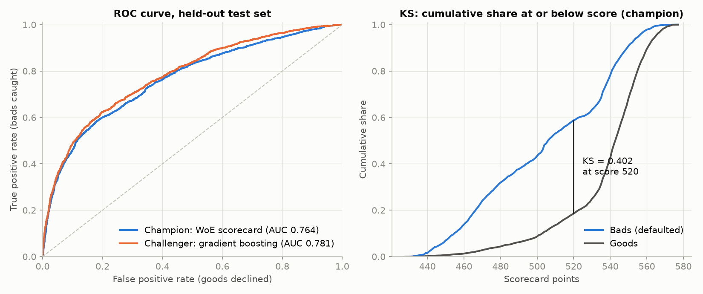
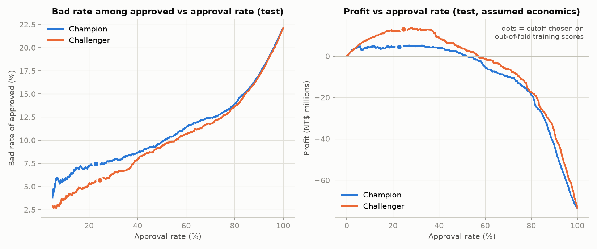

# Credit Risk Scorecard: WoE Logistic Regression vs Gradient Boosting

Can a transparent, bank-style points scorecard rank credit card default risk as well as gradient boosting? Close, not quite: held-out test AUC 0.7640 vs 0.7807, a small but statistically real gap.

     

<table>
<tr>
<td width="50%"></td>
<td width="50%"></td>
</tr>
</table>

## Results

Held-out test set, 9,000 accounts, used once ([`reports/metrics.json`](reports/metrics.json)):

| Metric | Scorecard (champion) | GBM (challenger) |
|---|---|---|
| Test AUC | 0.7640 | 0.7807 |
| Test KS | 0.4038 | 0.4245 |
| Hosmer-Lemeshow p (10 deciles) | 0.0002 | 0.285 |
| Profit at profit-maximising cutoff (NT$) | 4.53M | 13.02M |

AUC lift of the challenger: 0.0167, paired-bootstrap 95% CI 0.0123 to 0.0209. Minimum age-band adverse impact ratio at the cutoff: 0.255 (scorecard), flagged in the fairness check.

## Proof

- **11 tests** (`pytest`): WoE/IV, monotonic binning, PDO points formula, KS, PSI.
- **One command:** `make` builds the venv, runs the pipeline (about 50 seconds) and the tests.
- **Data:** [UCI Default of Credit Card Clients](https://archive.ics.uci.edu/dataset/350/default+of+credit+card+clients) (30,000 accounts); raw zip cached in `data/`, SHA-256 recorded in `reports/metrics.json`.
- **Deterministic:** seed 42 everywhere; reruns reproduce every report and figure (only the recorded runtime changes).
- **Protocol:** stratified 70/30 split; binning, variable selection, challenger tuning and the cutoff are all chosen by 5-fold CV on train, with the whole scorecard pipeline refit inside each fold.

## Stack

Python 3.14 · numpy 2.5.4 · pandas 3.1.0 · scipy 1.18.1 · scikit-learn 1.9.1 · matplotlib 3.11.2 · xlrd 2.0.2 · pytest 9.2.0

## Run

```bash
python3 -m venv .venv && .venv/bin/pip install -r requirements.txt
.venv/bin/python run.py && .venv/bin/python -m pytest -q
```

## Structure

```
run.py            end-to-end pipeline
src/scorecard/    data, woe (binning, IV), model (selection, LR, GBM), points,
                  metrics (KS, Gini, PSI, Hosmer-Lemeshow), business, plots
tests/            WoE/IV, points formula, KS, PSI
data/             cached UCI zip and field notes
reports/          every number quoted (CSV/JSON, generated)
figures/          PNG charts (generated)
```

---

Full method, limitations and interview-level detail: [docs/DETAILS.md](docs/DETAILS.md) · MIT License
